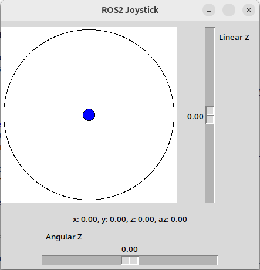

# simple_virtual_joystick

A simple ROS 2 virtual joystick that publishes `geometry_msgs/msg/Twist` or `geometry_msgs/msg/TwistStamped` using your mouse.

For when a real controller is just too far away from your desk.  
It provides a 2D axis, a vertical slider for linear Z, and a horizontal slider for angular Z, publishing on a twist/twiststamped topic.  
Originally created to control x, y, yaw, and altitude of a drone (4 DOF) when no suitable tool was available.



## Dependencies
- Using tkinter, so `sudo apt install python3-tk`
- `rclpy`, `geometry_msgs`, `ros2launch`

## Install
```bash
# From your ROS 2 workspace src directory
git clone <repo_url> simple_virtual_joystick
cd ..
rosdep install -i --from-path src --rosdistro jazzy -y
colcon build --packages-select simple_virtual_joystick
source install/setup.bash
```

## Run
```bash
ros2 launch simple_virtual_joystick simple_virtual_joystick.launch.py
```

### Launch arguments
- `topic` (default: `/cmd_vel_teleop`) - Topic name to publish to
- `stamped` (default: `true`) - Publish `TwistStamped` if `true`, else `Twist`
- `frame` (default: `base_link`) - Frame ID for `TwistStamped` header
- `use_sim_time` (default: `false`) - Use simulation time
- `timer_interval_ms` (default: `10`) - Publishing interval in milliseconds

### Run directly
```bash
ros2 run simple_virtual_joystick simple_virtual_joystick
```

## Alternatives
- [rqt_virtual_joystick](https://github.com/amgaber95/rqt_virtual_joystick) - Much fancier rqt plugin, but no additional sliders for z and yaw
